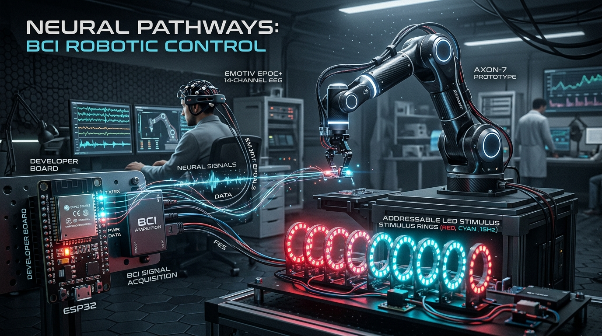

# BCI Robotic Arm Visual Stimulator & Neural Interface System



[](https://www.espressif.com/)
[](https://platformio.org/)
[](https://isocpp.org/)
[](https://www.adafruit.com/category/168)
[](https://en.wikipedia.org/wiki/Universal_asynchronous_receiver-transmitter)
[](LICENSE)

---

## 📌 Project Overview

The **BCI Robotic Arm Visual Stimulator** is a high-precision embedded stimulation and telemetry engine engineered on the **Espressif ESP32** architecture. Designed specifically for **Brain-Computer Interface (BCI)** applications—such as neural-controlled robotic manipulators, assistive prosthetics, and neural spellers—this system generates strictly timed, frequency-accurate visual stimuli to evoke **Steady-State Visual Evoked Potentials (SSVEP)** and **P300 Event-Related Potentials** in user electroencephalography (EEG) brain signals.

In BCI-driven robotic systems, the visual stimulus serves as the crucial optical bridge: by focusing gaze on specific flickering targets representing robotic spatial coordinates (e.g., reaching directions, target grasp locations, or joint trajectories), the human occipital and parietal lobes generate phase- and frequency-locked brainwaves. An external host system processes these neural signals and commands the robotic arm to execute the intended spatial task.

### 🌟 Why This Matters & Its Real-World Impact
- **Assistive Independence**: Offers hands-free, motor-free control pathways for individuals with neuromuscular disorders (e.g., ALS, spinal cord injuries, quadriplegia).
- **Sub-Millisecond Timing Stability**: Avoids the screen refresh rate jitter (e.g., standard 60 Hz display refresh limitations) by driving physical high-speed WS2812B LEDs directly via microsecond-level micro-controller hardware timers.
- **Dual Operating Architectures**: Features both an automated high-throughput Serial UART telemetry system (with onboard EEPROM persistence) and a standalone wireless Wi-Fi Access Point web dashboard for rapid clinical calibration.

---

## 🏗️ System Architecture & Dataflow Pipeline

```
+-----------------------------------------------------------------------------------------+
|                                1. VISUAL STIMULATION LAYER                              |
|                                                                                         |
|   +-----------------------+     GPIO 4 (800 kHz)     +------------------------------+   |
|   |  ESP32 Microcontroller| -----------------------> | WS2812B NeoPixel Stimulators |   |
|   |  (LX6 Dual-Core 240M) |                          |  - 6-Station Ring Array (72) |   |
|   +-----------+-----------+                          |  - 3x3 Matrix Grid (9)       |   |
+---------------|-----------------------------------------------------|-------------------+
                |                                                     | Optical Gaze
                | UART (115200) / Wi-Fi SoftAP                        | Stimulus
                v                                                     v
+-------------------------------+                     +-------------------------------+
|      HOST PC & TELEMETRY      |                     |       HUMAN USER & EEG        |
|  - Mode & Frequency Control   |                     |  - Visual Evoked Potentials   |
|  - Real-Time Parameter Sync   |                     |    (SSVEP / P300 Response)    |
|  - EEPROM Non-Volatile Memory |                     |  - 14/32/64-Channel EEG Cap   |
+---------------+---------------+                     +---------------+---------------+
                |                                                     |
                |                                                     | Microvolt Neural
                |                                                     | Signals
                v                                                     v
+-----------------------------------------------------------------------------------------+
|                                 2. NEURAL PROCESSING ENGINE                             |
|                                                                                         |
|       Raw EEG Telemetry  ===>  Bandpass Filtering (4-40 Hz) / Notch (50/60 Hz)          |
|                                         ||                                              |
|                                         v                                               |
|           Spatial Filtering & Feature Extraction (CCA / FBCCA / Wavelet Transform)      |
|                                         ||                                              |
|                                         v                                               |
|        Classification Engine (Deep 1D-CNN / Transformer / LSTM / Linear Discriminant)   |
+-----------------------------------------------------------------------------------------+
                                          |
                                          | Decoded Target Intent
                                          v
+-----------------------------------------------------------------------------------------+
|                                  3. ROBOTIC ACTUATION                                   |
|                                                                                         |
|       +------------------------------------+    Forward / Inverse Kinematics            |
|       | 6-DOF Robotic Arm Manipulator      | <------------------------------------+     |
|       | Target Station Reaching & Grasping |                                            |
|       +------------------------------------+                                            |
+-----------------------------------------------------------------------------------------+
```

---

## ⚡ Core Technical Features

- **Microsecond-Accurate Pulse Generation**: Implements a non-blocking FreeRTOS-friendly state machine via `millis()` ensuring precise duty cycles across frequencies ranging from **2.0 Hz to 20.0 Hz** (and up to **60 Hz** in Wi-Fi mode).
- **Dual Firmware Operating Paradigms**:
  1. **Spatial Multi-Station Firmware (`bci_led -3`)**: Controls **72 WS2812B LEDs** distributed across **6 distinct spatial target places** (12 LEDs per place). Supports sequential place flashing (Mode 1) and grouped column/row flashing (Mode 2) with automated rest cycles.
  2. **Wireless Web-Controlled Matrix Firmware (`final code.txt`)**: Hosts a **Wi-Fi SoftAP** (`BCI_Stimulus_AP`) and serves a dark-themed responsive dashboard via `ESPAsyncWebServer` for direct dynamic adjustment of frequency, duty cycle, intervals, and RGB hex colors.
- **Robust UART Command Interface**: Supports full real-time bidirectional parameter orchestration over Serial at 115200 Baud (`FETCH`, `STARTM1`, `STARTM2`, `STOP`, `M1SEQ`, `M1`, `M2`).
- **Non-Volatile Parameter Persistence**: Saves stimulation frequencies, durations, and RGB color profiles directly to ESP32 **EEPROM** (512 bytes) validated with a magic signature (`0xAABBCCDD`), surviving unexpected power cycles.
- **Visual Boot Diagnostics**: Built-in `showFlowingRadiant()` optical startup sequence verifies electrical continuity and LED channel health across all connected pixels before arming the stimulus.

---

## 🔌 Bill of Materials (BOM) & Hardware Connections

### Bill of Materials
| Component | Specification / Model | Quantity | Purpose |
| :--- | :--- | :---: | :--- |
| **Microcontroller** | ESP32-WROOM-32 / NodeMCU ESP-32S | 1 | Real-time stimulus timing, Serial parsing, Wi-Fi AP |
| **Addressable LEDs** | WS2812B NeoPixel (Ring / Strip / Matrix) | 9 to 72 | Optical flicker targets for SSVEP/P300 elicitation |
| **Power Supply** | 5V DC @ 2A – 3A Regulated | 1 | Powers ESP32 and high-draw NeoPixel LED arrays |
| **Logic / Wiring** | 22 AWG hookup wire + 330Ω resistor | 1 Set | Power distribution & data line ringing protection |
| **Capacitor** | 1000 µF, 6.3V or higher electrolytic | 1 | Decoupling capacitor across 5V and GND power rails |
| **Host Interface** | Micro-USB to USB-A Cable | 1 | 115200 Baud serial communication & firmware flashing |

### Pinout Mapping
| ESP32 Pin | Connected Component | Function / Signal | Notes |
| :--- | :--- | :--- | :--- |
| **GPIO 4** | NeoPixel Strip / Matrix DIN | Data In (800 kHz signal) | Main PWM/RMT data transmission line |
| **GND** | WS2812B GND & Power Supply GND | Common Ground | Essential to tie all grounds together |
| **5V / VIN** | External 5V Power Supply (+5V) | System Power | For >12 LEDs, feed 5V externally to avoid brownouts |
| **GPIO 1 (TX0)** | Host PC / USB-UART | Serial Transmit | 115200 Baud telemetry & status feedback |
| **GPIO 3 (RX0)** | Host PC / USB-UART | Serial Receive | 115200 Baud command ingestion |

---

## 💻 Repository Directory Structure

```plaintext
BCI Robo arm/
├── assets/
│   ├── banner.png                  # High-tech repository banner
│   ├── photos/                     # Physical hardware and setup photos (.gitkeep)
│   └── videos/                     # Demo video clips and animations (.gitkeep)
├── bci_led -3/                     # Primary PlatformIO Project (72 LEDs, 6 Stations, Serial + EEPROM)
│   └── bci_led -3/
│       ├── platformio.ini          # PlatformIO environment config for esp32dev
│       └── src/
│           └── main.cpp            # 72-LED SSVEP stimulus state machine with EEPROM & UART parser
├── bci_led -2/                     # Incremental staging build for LED array
├── bci_led/                        # Baseline PlatformIO firmware build
├── New folder/                     # Curated academic research literature on BCI & Motor Imagery
│   ├── BrainComputer_InterfaceA_Brain-in-the-Loop_Communication_System.pdf
│   ├── MotorImageryClassificationUsingConvolutionalNeuralNetworks.pdf
│   └── ... (12 specialized peer-reviewed papers)
├── final code.txt                  # Standalone ESP32 Wi-Fi AP + Async Web Server stimulus controller (C++)
├── 20251209_162811.mp4             # High-resolution benchmark demonstration recording (Local)
├── 20251209_163310.mp4             # High-resolution benchmark demonstration recording (Local)
├── .gitignore                      # Configured to exclude build artifacts and large files
└── README.md                       # Complete technical documentation
```

---

## 🛠️ Installation & Setup Guide

### 1. Embedded Firmware Deployment (PlatformIO)

The recommended setup runs via **VS Code** with the **PlatformIO IDE** extension.

1. Connect the ESP32 board to your computer via micro-USB.
2. Open the directory `bci_led -3/bci_led -3/` in PlatformIO or VS Code.
3. Verify your `platformio.ini`:
   ```ini
   [env:esp32dev]
   platform = espressif32
   board = esp32dev
   framework = arduino
   lib_deps = adafruit/Adafruit NeoPixel@^1.15.2
   ```
4. Build and flash the firmware:
   ```bash
   pio run --target upload
   ```
5. Open the serial monitor at **115200 baud**:
   ```bash
   pio device monitor -b 115200
   ```

### 2. Standalone Web Controller Setup (`final code.txt`)

If using the Wi-Fi AP 3x3 matrix controller:
1. Open the Arduino IDE.
2. Ensure you have installed the required libraries:
   - `Adafruit_NeoPixel`
   - `ESPAsyncWebServer`
   - `AsyncTCP`
3. Load the code from `final code.txt`, select board **ESP32 Dev Module**, and click **Upload**.
4. On your PC or smartphone, connect to the Wi-Fi Access Point:
   - **SSID**: `BCI_Stimulus_AP`
   - **Password**: `bci-password`
5. Open your browser and navigate to `http://192.168.4.1` to access the interactive real-time stimulus dashboard.

---

## 📡 Serial Telemetry Command Reference (`bci_led -3`)

When connected over UART at **115200 Baud**, the firmware parses newline-terminated (`\n` or `\r`) commands:

| Command | Syntax / Parameters | Description |
| :--- | :--- | :--- |
| `FETCH` | `FETCH` | Returns current Mode 1 & 2 frequencies, durations, brightness, colors, and sequence |
| `STARTM1` | `STARTM1` | Starts Mode 1 sequential flickering across the 6 targets |
| `STARTM2` | `STARTM2` | Initiates Mode 2 with a 90-second countdown delay |
| `STOP` | `STOP` | Immediately clears all LEDs and halts the active stimulus engine |
| `M1SEQ` | `M1SEQ,p0,p1,p2,p3,p4,p5` | Sets the sequential order of the 6 targets (e.g., `M1SEQ,0,1,2,3,4,5`) |
| `M1` | `M1,f0,f1,f2,f3,f4,f5,flickDur,pauseDur,bright,color` | Configures Mode 1 (e.g., `M1,5.0,7.5,10.0,12.0,14.0,15.0,3,2,150,RED`) |
| `M2` | `M2,f0,f1,f2,f3,f4,flickDur,pauseDur,bright,color` | Configures Mode 2 parameters (columns & rows) |

---

## 📸 Media & Hardware Demonstration

### Physical Hardware & Setup Showcase
High-resolution photos showcasing the physical ESP32 wiring, custom optical diffuser mounts, and robotic arm workstation are located in `assets/photos/`:

| Hardware Rig Front View | Target Cluster Array | Wiring & Controller Hub |
| :---: | :---: | :---: |
|  |  |  |
*(Add photos to `assets/photos/` and update references above)*

### Live Video Demonstrations
Video recordings highlighting the frequency calibration and robotic arm coordination are cataloged in `assets/videos/`:
- **Real-Time SSVEP Multi-Frequency Stimulus Calibration**: `assets/videos/stimulus_demo.mp4`
- **BCI Closed-Loop Robotic Arm Target Reach Demonstration**: `assets/videos/bci_arm_reach.mp4`
*(Local high-definition archive recordings `20251209_162811.mp4` and `20251209_163310.mp4` are preserved in your workspace).*

---

## 🔬 Scientific Foundations & Literature Reference

This project builds upon published research in motor imagery, wavelet-based feature extraction, and convolutional neural architectures for EEG classification. The repository includes relevant reference literature in [`New folder/`](New%20folder/):
- **Motor Imagery & Deep Learning**: CNN-Transformer-LSTM multi-channel EEG signal classification.
- **Wavelet Scattering Transforms**: Robust time-frequency representations of non-stationary EEG microvolt responses.
- **Brain-in-the-Loop Robotics**: Closed-loop sensory feedback and target selection paradigms for assistive robotic manipulators.

---

## 🚀 Git Initialization & Publishing to GitHub

Follow these sequential steps in PowerShell or your terminal to initialize Git, make your initial commit, and open the project directly in **GitHub Desktop**:

```powershell
# 1. Initialize local git repository
git init

# 2. Stage the files safely (respecting .gitignore which excludes large binaries and >100MB videos)
git add .

# 3. Create your initial production commit
git commit -m "feat: initial commit of BCI robotic arm visual stimulator firmware and documentation"

# 4. (Optional) Set default branch to main
git branch -M main
```

### Opening in GitHub Desktop:
1. Open **GitHub Desktop**.
2. Click **File** > **Add Local Repository...** (or press `Ctrl + O`).
3. Browse and select `c:\Users\Samim Akhtar\Desktop\BCI Robo arm`.
4. Click **Add Repository**.
5. Click **Publish repository** to create and sync your private or public repository directly on your GitHub profile.

---

## 📜 License

This project is licensed under the **MIT License** - see the [LICENSE](LICENSE) file for details.
